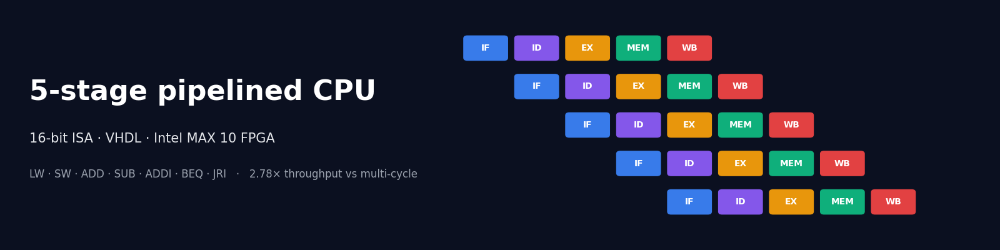
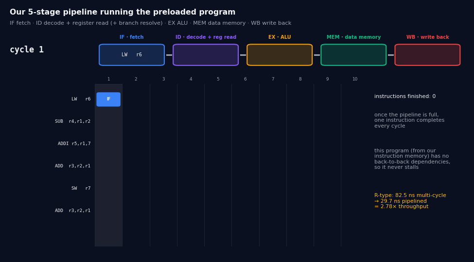
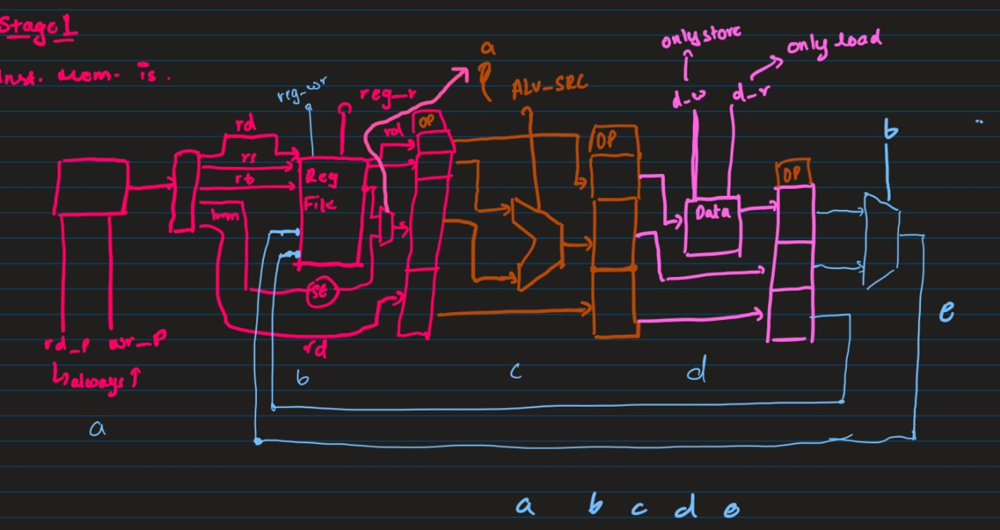
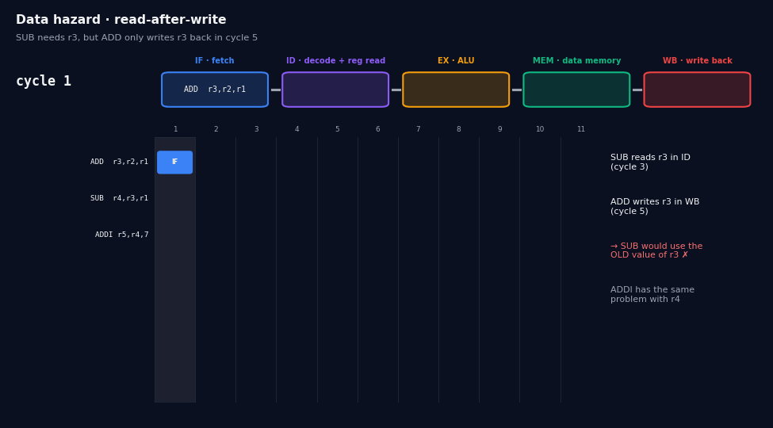
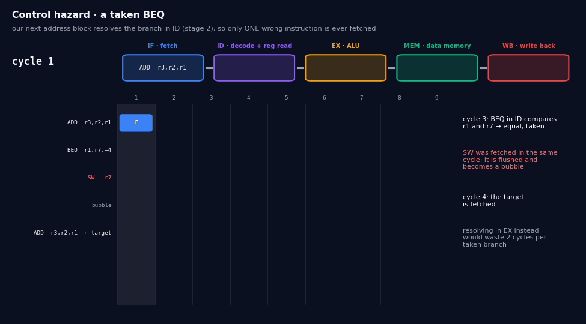
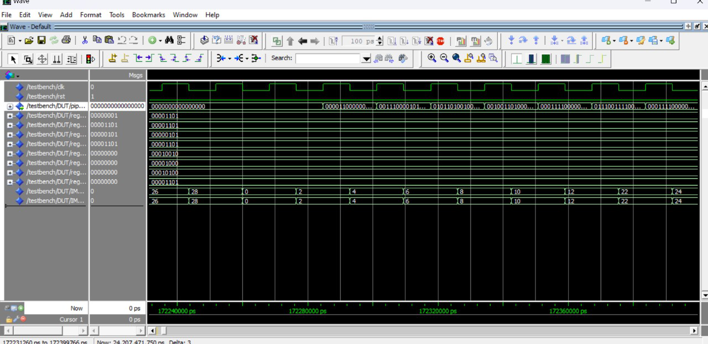

<p align="center">
  
</p>

<p align="center">
  
  
  
  
  
  <a href="docs/report.pdf"></a>
</p>

> **TL;DR.** A **5-stage pipelined processor** designed in VHDL with my team and synthesised for an **Intel MAX 10 FPGA** in Quartus Prime. It runs a small 16-bit instruction set (LW, SW, ADD, SUB, ADDI, BEQ, JRI) through Fetch → Decode → Execute → Memory → Write-back. Each stage is its own VHDL module, separated by four clocked pipeline registers, and branches are resolved early in the decode stage. Compared with our earlier multi-cycle design, an R-type instruction takes **29.7 ns instead of 82.5 ns, a 2.78× throughput gain**, with a **16.5 ns** clock period after place-and-route.

---

## Pipeline in action

The animation runs the program that is preloaded in our instruction memory ([`rtl/RING_BUFFER.vhd`](rtl/RING_BUFFER.vhd)). Once the pipeline fills, one instruction finishes every cycle:

<p align="center"></p>

## Datapath

```mermaid
flowchart LR
    IF["IF<br/>instruction memory<br/>(ring buffer, 32×16)"] --> P1[["PR 1-2<br/>instruction, PC"]]
    P1 --> ID["ID<br/>register file read<br/>sign-extend<br/>next-address block"]
    ID --> P2[["PR 2-3<br/>opcode, rd, rs,<br/>operand 2, rd index"]]
    P2 --> EX["EX<br/>8-bit ALU"]
    EX --> P3[["PR 3-4<br/>opcode, rd, ALU result,<br/>rd index"]]
    P3 --> MEM["MEM<br/>data memory<br/>(ring buffer)"]
    MEM --> P4[["PR 4-5<br/>opcode, mem data,<br/>ALU result, rd index"]]
    P4 --> WB["WB<br/>mux: ALU or memory<br/>→ register file"]
    ID -. "branch / jump target" .-> IF
    classDef s fill:#e8f0fc,stroke:#1f5fbf,color:#0b1a33
    classDef r fill:#fff4dc,stroke:#e0a100,color:#3d2c00
    class IF,ID,EX,MEM,WB s
    class P1,P2,P3,P4 r
```

<p align="center">
  
  <br><sub>Our datapath sketch: stages a–e separated by the pipeline registers (the tall boxes), with the opcode (OP) travelling along with each instruction.</sub>
</p>



**Design choices**
- **Four synchronous pipeline registers** ([`pr_1_2` … `pr_4_5`](rtl)). Everything between them (ALU, multiplexers, next-address block, program counter) is combinational logic, so each stage is one clock period.
- **The opcode travels with the instruction** through every pipeline register. Each stage decodes its own control signals locally, so no central controller is needed.
- **Branches are resolved in ID.** A next-address block in the decode stage ([`next_addr_bl.vhd`](rtl/next_addr_bl.vhd), [`beq_check.vhd`](rtl/beq_check.vhd)) compares the registers and computes the target. A taken branch therefore costs only one cycle (see below).
- **Ring-buffer memories.** Instruction memory (32 × 16 bit) and data memory (8-bit words) use head and tail pointers that wrap from 31 to 0. The program counter moves the instruction memory's read pointer.

## Instruction set

| Instruction | Opcode | Format | What it does |
|---|:---:|---|---|
| `LW`   | `0000` | opcode · reg (3) · imm (9) | load a word from data memory into a register |
| `SW`   | `0001` | opcode · reg (3) · imm (9) | store a register to data memory |
| `ADD`  | `0010` | opcode · rd · rs · rt | rd = rs + rt |
| `SUB`  | `0011` | opcode · rd · rs · rt | rd = rs − rt |
| `ADDI` | `0101` | opcode · rd · rs · imm (6) | rd = rs + imm |
| `JRI`  | `0110` | opcode · reg · imm | jump to register + immediate |
| `BEQ`  | `0111` | opcode · ra · rb · imm (6) | branch if ra = rb |

16-bit instructions and 8 registers. The ALU ([`alu_new.vhd`](rtl/alu_new.vhd)) is 8-bit, and the PC and branch adder are 16-bit.

## Hazards, stalls and bubbles

A pipeline overlaps instructions, so an instruction can need a result that has not been written back yet. Our processor has **no hardware hazard unit**. Its programs are scheduled so that no instruction depends on the one right before it, which is why the program above never stalls. The animation shows what goes wrong otherwise, and the two standard hardware fixes:
- **No handling:** SUB reads r3 two cycles before ADD writes it.
- **Stalling:** the dependent instruction waits in decode while **bubbles** (no-ops) flow down the pipeline.
- **Forwarding:** the result goes straight from the pipeline register back into the ALU, with no bubbles.
- **Load-use:** even with forwarding, one bubble remains after a load.

<p align="center"></p>

**Control hazards** are where our design choice pays off. Because BEQ is decided in the decode stage, only the single instruction fetched behind a taken branch has to be flushed. Resolving it in execute would waste two.

<p align="center"></p>

<sub>The animations come from a cycle-by-cycle model of this 5-stage pipeline ([`docs/make_figures.py`](docs/make_figures.py)). The stall and forwarding scenes show standard techniques for comparison; they are not part of our VHDL.</sub>

## Results

**FPGA implementation** (Quartus Prime 18.1 Lite, Intel MAX 10 `10M25SAE144C8G`):

| | |
|---|---|
| Logic elements | 748 / 24,960 (3 %) |
| Registers | 439 |
| Clock period | **16.5 ns** (≈ 60 MHz) |
| R-type instruction time | 82.5 ns (multi-cycle) → **29.7 ns** (pipelined): **2.78×** |

| Timing model | Setup slack | Hold slack | Min. pulse-width slack |
|---|:---:|:---:|:---:|
| Slow | 0.160 ns | 0.412 ns | 7.808 ns |
| Fast | 5.554 ns | 0.163 ns | 7.674 ns |
| Post-fit | 0.456 ns | 0.368 ns | 7.755 ns |

**Simulation.** Here a jump in stage 2 (base 0, immediate 5) moves the instruction-memory tail pointer from 12 to 22. Addresses step by two, so the immediate is doubled.

<p align="center"></p>

---

## Repository

```
rtl/                 VHDL of the final pipelined processor (top level: PROC.vhd) and its testbench
rtl/first_version/   the first pipelined version: R-type, LW and SW only, no branches yet
quartus/             Quartus project (.qpf/.qsf) and the synthesis, fit, timing and power summaries
docs/                project report, datapath sketch, simulation waveform, animations and the script that draws them
```

<details open>
<summary><b>What every VHDL file does</b></summary>

| File | Role |
|---|---|
| `PROC.vhd` | top level: instantiates all stages and wires the pipeline together |
| `RING_BUFFER.vhd` | instruction memory (32 × 16-bit ring buffer, preloaded program) |
| `RING_BUFFERMEM.vhd` | data memory (8-bit ring buffer, read for LW, write for SW) |
| `pr_1_2.vhd` … `pr_4_5.vhd` | the four pipeline registers |
| `reg_file.vhd` | 8-register file: two reads in ID, one write in WB |
| `alu_new.vhd` | ALU: ADD, SUB, ADDI, pass-through for LW / SW |
| `program_counter.vhd`, `pc_inc_mux.vhd` | PC and its next-value selection |
| `next_addr_bl.vhd`, `beq_check.vhd`, `add_16bit.vhd` | next-address block in ID: branch comparison and target adder (BEQ, JRI) |
| `se_6to8`, `se_7to16`, `se8to16`, `se_10to16`, `concat_2z_ze*` | sign / zero extension of immediates |
| `mux*.vhd` | operand, write-back and address multiplexers |
| `testbench.vhd` | clock and reset stimulus for simulation |

</details>

## Team

A four-person team project for the Microprocessors course at IIT Bombay (2025). The [report](docs/report.pdf) has the full details.
